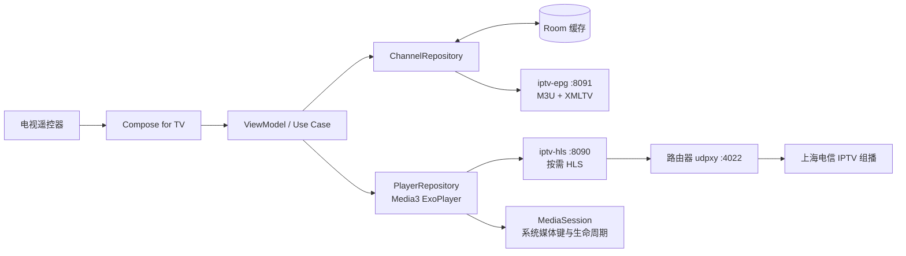

# Android TV 应用详细设计

> 状态：`0.5.0` 当前阶段的代码开发、正式签名 APK 和 GitHub Release 已完成。在 `0.4.0` 的播放器、缓存、诊断、遥控器和手机扫码配置上，新增正式版自动检查、下载、完整性/签名校验及系统确认安装流程。长期 release keystore、GitHub Secrets、云端签名 dry-run、正式发布资产和固定更新地址均已验证；相关 JVM 测试、本地编译和更新后的 API 34/API 36 Android TV 模拟器关键遥控器路径均已通过。用户于 2026-11-16 决定暂时跳过真实设备验证，同签名升级/回滚和物理电视安装继续作为延期风险保留，明细见[《Android TV 开发验证记录》](android-tv-test-report.md)。

## 1. 产品定义

### 1.1 产品目标

应用暂定名为“家庭电视”，面向家庭局域网内的 Android TV / Google TV 设备。它把现有 NAS 提供的 HLS 直播和 XMLTV 节目单组织成适合电视遥控器操作的直播体验。

v1 必须做到：

1. 首次配置后，后续启动不需要键盘、鼠标或触摸屏。
2. 从频道列表到开始播放不超过两次确认键操作。
3. 全屏播放时可以仅用方向键完成换台、查看当前/下一节目和返回频道列表。
4. EPG 不可用时仍能播放直播；直播不可用时能说明故障发生在电视、NAS 还是节目源。
5. 不接触 IPTV 账号、机顶盒 SN、DHCP Option 或组播认证；应用只访问 NAS 的 HTTP 接口。

### 1.2 v1 范围

- 导入一份 M3U 播放列表，可选独立 XMLTV 地址。
- 频道分组、收藏、最近观看和频道名称搜索。
- 当前节目、下一节目以及未来节目列表。
- HLS 全屏直播、上下换台、音轨和字幕选择。
- 自动重试、诊断页、离线元数据缓存和 EPG 过期提示。
- 适配五向遥控器、媒体键和常见数字键。
- 生成可侧载安装的正式签名 APK；长期 release keystore、加密备份、GitHub Secrets、云端签名 dry-run、`0.5.0` 正式签名 APK 和 GitHub Release 均已完成。应用商店发布不属于 v1 必交范围。
- 正式版从 GitHub Release 检查更新，下载并验证后调用 Android 系统安装界面；开发版不参与正式更新。

### 1.3 明确不做

- 不做直播录制、回看、时移、倍速和画中画。
- 不做用户账号、云同步、多家庭或远程公网播放。
- 不在电视端直接接收组播，也不在电视端运行 FFmpeg。
- 不模拟运营商机顶盒认证，不保存 IPTV 凭据。
- 不依赖触摸、鼠标、菜单键或手机扫码才能完成日常操作。
- v1 不做 Android TV 首页“直播”标签集成；稳定后再评估 `TvProvider`。

## 2. 运行前提与后端契约

### 2.1 当前家庭环境

| 项目 | 当前值 | 客户端用途 |
| --- | --- | --- |
| 播放列表 | `http://192.168.31.200:8091/playlist.m3u` | 频道 ID、名称和 HLS 地址 |
| XMLTV | `http://192.168.31.200:8091/epg.xml` | 当前、下一和未来节目 |
| EPG 状态 | `http://192.168.31.200:8091/status.json` | 更新时间、匹配数和未匹配频道 |
| EPG 健康 | `http://192.168.31.200:8091/healthz` | 元数据服务可用性 |
| HLS 健康 | `http://192.168.31.200:8090/healthz` | 媒体服务可用性 |
| HLS 状态 | `http://192.168.31.200:8090/api/status` | 已配置和正在播放的频道 |

安装包不得把当前地址作为不可修改的常量。开发版可以通过 `BuildConfig` 预填当前家庭地址，用户必须能在“设置 → 播放源”中修改并测试。

### 2.2 M3U 解析约定

- 读取首行 `x-tvg-url` 作为默认 XMLTV 地址；用户设置的 XMLTV 地址优先级更高。
- `tvg-id` 是跨刷新保持稳定的频道主键，必须与 XMLTV `<channel id>` 精确匹配。
- `tvg-name` 优先作为显示名称；缺失时使用逗号后的名称。
- 流地址使用相对 M3U 地址解析后得到的绝对 URL。
- 当前播放列表没有 `group-title` 和 `tvg-logo`，界面不得依赖它们。
- 缺少 `tvg-id` 的频道使用规范化 URL 的 SHA-256 前 16 位作为临时 ID，并在诊断页提示不稳定主键。
- 解析单条失败不能丢弃整份列表；保存错误行号并继续导入其余频道。

### 2.3 XMLTV 解析约定

- 使用流式解析，禁止把完整 XML 构造成常驻内存 DOM。
- 只保留当前时间前 6 小时至未来 7 天的节目。
- XMLTV 时间先按字段中的时区解析，再转换为设备时区显示。
- 节目以 `channel + start + stop` 作为唯一键；重复项后写覆盖前写。
- 没有 `stop` 的节目以同频道下一节目的开始时间补齐；仍无法补齐时只显示标题，不显示进度。
- EPG 下载或解析失败时保留上一份成功缓存，并显示缓存更新时间。

### 2.4 需要后端长期保持的稳定性

- `/playlist.m3u` 中同一频道的 `tvg-id` 不随名称变化而改变。
- HLS 地址保持 `/{channel-id}/index.m3u8` 结构。
- 健康接口只用于诊断，不能替代实际 HLS 播放验证。
- 客户端不依赖 `status.json` 中数组顺序或额外字段，未知字段必须忽略。

## 3. 用户与核心场景

### 3.1 主要用户

- 家庭成员：只关心快速开电视、换台和看节目单，不理解 M3U、HLS 或 NAS。
- 管理者：配置 NAS 地址、排查播放故障、查看 EPG 更新时间和服务状态。

### 3.2 核心任务

| 场景 | 成功路径 |
| --- | --- |
| 第一次使用 | 启动 → 遥控器输入或手机扫码填写来源 → 电视测试 → 电视确认导入 → 进入直播首页 |
| 日常观看 | 启动 → 焦点恢复到上次频道 → 确认键 → 全屏播放 |
| 快速换台 | 全屏播放 → 上/下 → 延迟 350 ms 后切换 → 频道横幅自动消失 |
| 找节目 | 首页切换分组或搜索 → 浏览当前节目 → 确认播放 |
| 看未来节目 | 首页右侧节目栏 → 查看未来节目，不提供预约或回看 |
| 故障排查 | 播放失败 → 重试 → 打开详情 → 诊断页看到故障层级和建议 |

## 4. 信息架构

```text
启动
├─ 未配置 ─> 首次设置
│           ├─ 播放列表地址
│           ├─ XMLTV 地址（自动发现，可覆盖）
│           ├─ 同网段手机扫码输入
│           └─ 连接测试与导入结果
└─ 已配置 ─> 直播首页
            ├─ 分组：全部 / 收藏 / 最近 / 上海 / 央视 / 卫视 / 4K / 其他
            ├─ 频道列表
            ├─ 当前与下一节目
            ├─ 搜索
            ├─ 设置
            └─ 全屏播放器
                ├─ 频道信息横幅
                ├─ 快速频道栏
                ├─ 节目单浮层
                ├─ 音轨 / 字幕
                └─ 播放错误与诊断入口
```

分组优先使用 M3U 的 `group-title`。当前列表没有分组时，使用确定性规则：名称包含“4K”进入 4K；CCTV/CETV 进入央视；名称包含“卫视”进入卫视；上海本地频道白名单进入上海；其余进入其他。收藏和最近是虚拟分组，始终位于最前。

## 5. 视觉与布局规范

### 5.1 设计方向

- 默认深色界面，让视频内容成为视觉主体；不用大面积渐变或装饰背景。
- 使用安静的中性色，焦点态使用高对比实色和轻微放大，错误才使用红色。
- 频道没有台标时使用名称的 2–4 个字符生成文字标识，不伪造图标。
- 按 10 英尺观看距离设计，正文不小于 18sp，关键频道名 24–32sp。
- 重要内容位于 5% 安全区内，避免电视过扫描裁切。
- 所有页面横屏全屏显示，不出现透明窗口、手机式底部导航或需要滚动触摸的控件。

### 5.2 直播首页

首页使用三列结构：

| 区域 | 建议宽度 | 内容 |
| --- | ---: | --- |
| 分组栏 | 18% | 分组、搜索、设置；焦点离开后可收窄 |
| 频道栏 | 34% | 频道号、名称、当前节目、进度、收藏状态 |
| 节目区 | 48% | 当前节目详情、下一节目、后续列表和静音预览占位 |

默认焦点在上次观看频道。首页不自动播放，避免每次启动都在 NAS 上启动 FFmpeg。频道获得焦点 800 ms 后，可以选择加载静音预览；v1 默认关闭预览，防止浏览列表时频繁启动流。

频道行需要同时显示频道名称和当前节目。EPG 缺失时显示“暂无节目单”，不能隐藏频道。节目进度条只在 `start` 和 `stop` 都有效时显示。

### 5.3 全屏播放器

- 视频铺满屏幕，保持原始宽高比；信号本身存在黑边时不裁切。
- 切台或按确认键时，底部显示频道横幅：频道号、名称、当前节目、时间范围、进度和下一节目。
- 横幅 5 秒无操作后淡出；焦点位于浮层时不自动关闭。
- 缓冲超过 800 ms 才显示加载提示，避免短暂缓冲闪烁。
- 切台时立即更新频道文字，实际播放器在 350 ms 防抖后切换，连续按键只播放最终频道。
- 播放失败浮层不覆盖完整错误堆栈，只显示结论、重试倒计时、“立即重试”和“查看详情”。

### 5.4 首次设置

首次设置只包含一个主流程：

1. 播放列表地址，预填构建配置提供的家庭地址。
2. “测试连接”读取 M3U，并自动发现 `x-tvg-url`。
3. 展示频道数量、XMLTV 可用性和健康检查结果。
4. 选取第一个可用频道读取 HLS 播放列表，确认不是只有健康接口可用。
5. 用户确认“保存并进入直播”。

地址输入支持遥控器软键盘、ADB 输入和同网段手机扫码输入。扫码流程为：电视启动临时 HTTP 表单并显示本地生成的二维码；手机提交后电视执行与遥控器输入相同的来源测试；测试通过后仍需电视端确认保存。测试失败时保留输入值，不允许在没有任何可播放频道时完成设置。

扫码服务仅在二维码弹窗打开时运行。会话使用 128 位随机令牌，十分钟过期，只接受与电视同一 IPv4 子网的客户端，请求体上限 8 KiB，单个 URL 上限 2048 个字符。关闭弹窗、应用进入后台或来源开始应用时立即停止服务。访客 Wi-Fi、AP 隔离和跨 VLAN 防火墙不承诺可用；二维码和网页均不经过公网服务。

### 5.5 设置与诊断

设置页分为：

- 播放源：播放列表 URL、XMLTV URL、测试和立即刷新。
- 播放：字幕默认值、当前音轨偏好和恢复自动。v1 固定启动进入首页并恢复上次频道焦点，换台固定使用 350 ms 防抖，不提供容易造成误操作的模式开关。
- 数据：节目单缓存更新时间、清空 EPG、清空最近观看、重置收藏。
- 诊断：电视网络、M3U、XMLTV、HLS 健康、样例频道实际播放、最近错误。
- 关于：版本和构建号；当前后端地址直接显示在播放源区域。许可证需要由项目所有者选定后再加入应用，v1 不虚构授权条款。

危险操作使用确认对话框；修改 URL 时先测试新地址，测试通过后才替换当前配置。

## 6. 遥控器和焦点设计

### 6.1 全局原则

- 任意时刻必须有且只有一个可见焦点。
- 页面返回时恢复离开前的焦点和滚动位置。
- 焦点不能进入屏幕外元素；列表滚动后焦点项保持在中间安全区域。
- 长按方向键允许连续移动，但网络请求不得随每个焦点事件触发。
- 不依赖 Menu 键。所有能力必须由五向键、返回键和屏幕内按钮到达。

### 6.2 按键映射

| 场景 | 上 / 下 | 左 / 右 | 确认 | 返回 | 播放暂停 | 数字键 |
| --- | --- | --- | --- | --- | --- | --- |
| 首页分组 | 移动分组 | 进入频道栏 | 选择分组 | 退出应用 | 无操作 | 跳到频道号 |
| 首页频道 | 移动频道 | 分组栏 / 节目区 | 全屏播放 | 退出应用 | 全屏播放 | 跳到频道号 |
| 首页节目区 | 移动节目 | 返回频道栏 | 展开节目详情 | 返回频道栏 | 无操作 | 跳到频道号 |
| 全屏无浮层 | 上一台 / 下一台 | 打开快速频道栏 | 显示频道横幅 | 回到首页 | 暂停/恢复并回到直播点 | 输入频道号 |
| 全屏有浮层 | 按浮层焦点移动 | 按浮层焦点移动 | 执行动作 | 先关闭浮层 | 暂停/恢复 | 输入频道号 |

频道号输入在最后一次数字键后 1.2 秒执行；不存在的编号显示“没有这个频道”，不退出当前播放。

### 6.3 返回键状态机

```text
对话框 -> 关闭对话框
播放器浮层 -> 关闭浮层
全屏播放器 -> 直播首页，并聚焦当前频道
搜索 / 设置 -> 直播首页，并恢复来源焦点
直播首页 -> Android TV 首页
```

不使用“双击返回退出”，也不弹出“是否退出”确认框。

## 7. 播放设计

### 7.1 播放器状态机

```text
Idle
  -> Preparing
  -> Buffering
  -> Playing
  -> Paused
  -> Playing

Preparing / Buffering / Playing
  -> Recovering（自动重试）
  -> Error（自动重试耗尽）

任意活动状态
  -> Switching（选择新频道）
  -> Preparing

页面退出 / Activity 停止
  -> Released
```

### 7.2 Media3 配置基线

- 使用 Media3 ExoPlayer 和 HLS 模块，播放当前后端生成的 MPEG-TS HLS。
- 使用单播放器实例；v1 不启用双播放器预加载，避免同时占用两个 HLS 会话。
- 频道切换复用播放器，通过 `setMediaItem`、`prepare`、`playWhenReady` 切换。
- `DefaultHttpDataSource` 设置连接超时 5 秒、读取超时 15 秒，并禁止跨协议重定向。
- 直播恢复默认回到 live edge，不承诺回到暂停位置。
- 创建 `MediaSession` 接收系统媒体键；应用进入后台、电视关屏或输入源切换时取消待执行的换台、重试和首帧计时并停止媒体请求，避免无人观看时继续消耗 NAS 资源；Activity 最终销毁时再释放播放器实例。
- 使用媒体用途、电影内容类型的 `AudioAttributes`，由 Media3 请求并处理音频焦点；焦点丢失时按系统策略暂停或抑制播放。
- 屏幕保持唤醒直接跟随 Media3 的 `isPlaying`，仅在播放器已就绪、用户要求播放且没有被音频焦点等原因抑制时生效。
- 开始播放或手动重试后等待首帧；30 秒仍未收到 `onRenderedFirstFrame` 时停止当前流，避免客户端和 NAS 无限维持无画面的会话。

### 7.3 重试策略

| 错误 | 自动行为 | 用户提示 |
| --- | --- | --- |
| 连接超时 / 临时断网 | 1、2、4 秒各重试一次 | 正在重新连接，第 n/3 次 |
| HTTP 404 | 不自动循环 | 频道配置已失效 |
| HTTP 502/503 | 最多重试 3 次 | NAS 正在启动频道或媒体服务异常 |
| 解码器错误 | 更换解码器回退一次 | 电视不支持该频道编码 |
| 30 秒没有首帧 | 停止当前流，不自动循环 | 可能是电视不支持频道编码，或直播流不完整；可重试、换台或查看诊断 |
| EPG 错误 | 不影响播放器 | 节目单暂不可用，继续播放直播 |

用户主动换台会取消旧频道的所有重试和首帧计时。错误发生后操作浮层不会自动隐藏，直到用户重试、换台或进入诊断。网络恢复时只恢复当前频道，不批量探测全部频道。

### 7.4 换台时序

```text
遥控器上/下
  -> UI 立即更新候选频道和频道横幅
  -> 350 ms 防抖，后续按键重置计时
  -> 取消旧频道的 prepare / retry
  -> PlayerRepository 设置最终频道 MediaItem
  -> NAS 按需启动对应 FFmpeg
  -> ExoPlayer 读取 index.m3u8 和媒体分片
  -> 首帧出现，记录换台耗时和最近观看
  -> 5 秒无操作后隐藏频道横幅
```

收藏、节目单查询和频道列表滚动都不能触发流请求；只有确认播放、全屏换台和首次设置中的实际播放测试可以启动 HLS。

## 8. 数据架构

### 8.1 本地模型

```text
SourceConfig
- id
- playlistUrl
- xmltvUrl
- lastSuccessfulSyncAt
- playlistEtag / lastModified
- epgEtag / lastModified

Channel
- id (tvg-id)
- number (播放列表顺序生成)
- name
- streamUrl
- groupName
- logoUrl?
- sourceOrder
- updatedAt

Programme
- channelId
- startAt
- stopAt?
- title
- subtitle?
- description?
- category?

Favorite
- channelId
- sortOrder

WatchHistory
- channelId
- lastWatchedAt
- totalWatchSeconds
```

### 8.2 存储选择

- Room：频道、节目单、收藏和最近观看，支持事务替换与查询。
- Preferences DataStore：URL、启动行为、字幕/音轨偏好和上次焦点。
- 内存：播放器状态、当前浮层、搜索文本和诊断会话。
- 不缓存视频分片；Media3 只使用播放缓冲，不配置持久化 `SimpleCache`。

### 8.3 同步策略

- 启动时先显示 Room 缓存，再后台刷新 M3U 和 XMLTV。
- 播放列表每 6 小时刷新一次，用户可手动刷新。
- XMLTV 每 6 小时刷新一次；与后端更新周期保持一致但不要求精确同步。
- 使用条件请求时尊重 ETag/Last-Modified；服务未提供时回退普通 GET。
- 新数据完整解析并校验后，在一个事务内替换；失败不能破坏旧缓存。
- 删除频道时保留收藏记录 30 天，频道重新出现后自动恢复收藏。

## 9. 技术架构

### 9.1 技术选型

- Kotlin。
- 单 Activity + Compose for TV。
- 页面由单 Activity、单 ViewModel 状态机管理；首版页面较少，不引入 Navigation Compose。
- AndroidX Media3 ExoPlayer、HLS 和 Session。
- OkHttp 负责 M3U/XMLTV/诊断请求。
- Room + DataStore 保存本地状态。
- NanoHTTPD 提供仅在扫码弹窗期间运行的固定路由局域网页；ZXing Core 在设备本地生成二维码。
- Kotlin Coroutines + Flow 管理异步和响应式状态。
- 依赖注入使用 Hilt；如首个原型希望更轻，可以先构造函数注入，但正式 v1 统一到 Hilt。
- `minSdk 23`、`compileSdk/targetSdk 36`；AGP 8.13.2、Gradle 8.13、Kotlin 2.2.10、Media3 1.11.1、Hilt 2.57.2、Room 2.7.2。

### 9.2 模块建议

```text
android-tv/app/src/
├─ main/java/.../data/    模型、M3U/XMLTV、Room、DataStore 与同步
├─ main/java/.../player/  单一 ExoPlayer、MediaSession 与轨道选择
├─ main/java/.../ui/      首次设置、首页、播放器、设置、二维码与诊断
├─ main/java/.../remote/  临时局域网页、令牌、同网段限制与手机提交
├─ main/java/.../di/      Hilt 提供数据库和网络组件
├─ main/res/              TV banner、图标、主题和网络安全配置
├─ test/                  M3U、XMLTV、条件请求、来源限制、分组与首页状态测试
└─ androidTest/           Room 跨版本迁移仪器测试
```

首版采用单 Gradle module，并按 `data`、`player`、`ui`、`di` 建立包边界。多模块拆分、Macrobenchmark 和 Baseline Profile 留到实机性能基线明确后再做。

### 9.3 单向数据流

```text
UI Event
  -> ViewModel
  -> Use Case / Repository
  -> Network + Database + Player
  -> StateFlow<UiState>
  -> Compose UI
```

播放器状态由 `PlayerRepository` 单一持有，频道首页和全屏页面不能各自创建 ExoPlayer。所有 URL 和错误日志在进入 UI 前脱敏，不记录查询参数中的潜在令牌。

### 9.4 运行时组件关系



EPG 路径与媒体路径独立：`iptv-epg` 故障只影响节目元数据，不能使 `PlayerRepository` 停止播放已有频道。HLS 健康接口成功也不能证明频道可播放，诊断必须读取一个真实频道的播放列表或分片。

### 9.5 Manifest 与网络安全

- 声明 `CATEGORY_LEANBACK_LAUNCHER`。
- 声明 `android.software.leanback`，不要求触摸屏。
- 只支持横屏，应用窗口使用不透明全屏背景。
- 需要 `INTERNET`、`ACCESS_NETWORK_STATE` 和 `WAKE_LOCK`；不申请存储、定位、麦克风或通知权限。
- 当前家庭服务是明文 HTTP，需要在 Network Security Config 中明确允许 cleartext。应用层仅接受 RFC 1918 地址、`.home.arpa` 和 `.local` 主机名作为明文 HTTP 来源；其他来源必须使用 HTTPS。应用不提供公网代理功能。
- 手机设置服务不监听公网地址，不进行端口映射；访问者必须与电视处于活动 IPv4 地址的同一子网并持有随机令牌。表单响应禁止缓存、嵌入和跨来源提交。
- target SDK 36 继续使用 `INTERNET` 的隐式局域网访问；升级 target SDK 37 或更高时必须声明并运行时申请 Android 17 的 `ACCESS_LOCAL_NETWORK` 权限。
- 应用图标需要 TV banner，不能只提供手机 launcher icon。

## 10. 状态、空态与错误文案

| 状态 | 页面表现 | 主操作 |
| --- | --- | --- |
| 首次未配置 | 地址输入和连接测试 | 测试连接 |
| 已有缓存、刷新中 | 立即显示旧频道，顶部小型刷新状态 | 继续观看 |
| 没有收藏 | 说明如何收藏，不显示空白列表 | 浏览全部频道 |
| 搜索无结果 | 保留搜索词 | 清除搜索 |
| EPG 缺失 | 频道仍可播放，节目位置显示暂无节目单 | 播放频道 |
| EPG 过期 | 显示上次更新时间 | 立即刷新 |
| HLS 首次启动 | 800 ms 后显示“正在打开频道” | 取消/换台 |
| 自动重试中 | 倒计时和次数 | 立即重试 |
| 重试失败 | 故障层级和简短建议 | 重试 / 查看详情 |
| NAS 不可达 | 显示播放列表、EPG、HLS 三项检查 | 打开诊断 |

错误页不得只显示“播放失败”。至少要包含频道、发生时间、错误类别、HTTP 状态或 Media3 错误码、是否已重试，以及建议下一步。

## 11. 可访问性与国际化

- 焦点态同时使用形状、尺寸和颜色，不只依靠颜色。
- 所有图标按钮提供中文语义标签；频道文字标识读作完整频道名。
- 支持系统字体缩放到 1.3 倍仍不截断主要操作。
- 动画遵循系统减少动态效果；焦点放大和浮层转场控制在 150–220 ms。
- 所有时间使用设备 12/24 小时制偏好，日期和星期使用系统 Locale。
- v1 文案只提供简体中文，但资源必须放在 `strings.xml`，不得直接写在 Composable 中。

## 12. 性能目标

| 指标 | 目标 |
| --- | ---: |
| 有缓存冷启动到首页可操作 | ≤ 2 秒 |
| 首页焦点移动响应 | ≤ 100 ms |
| 频道确认到首帧，中位数 | ≤ 4 秒 |
| 连续换台最终频道开始准备 | 最后按键后 ≤ 500 ms |
| M3U 112 个频道导入 | ≤ 1 秒 |
| 约 14,000 条节目解析和入库 | ≤ 5 秒，不阻塞主线程 |
| 稳定播放 1 小时 | 无崩溃、无音画不同步持续恶化 |
| 空闲首页 | 不保持 HLS 连接，不在 NAS 上保留活跃 FFmpeg |

这些数值需要在实际电视和当前家庭网络上测量，模拟器结果不能作为最终验收依据。

## 13. 测试设计

### 13.1 自动化测试

- M3U：缺字段、相对 URL、重复 ID、中文名称、坏行和 112 频道真实样本。
- XMLTV：时区、无 stop、重复节目、未知频道、超大文件和损坏 XML。
- Repository：缓存优先、事务替换、刷新失败保留旧数据；API 34 设备测试使用真实 Room 与 MockWebServer 验证播放列表失败不清空频道、EPG 失败不清空节目单，并分别报告 EPG/HLS 服务故障。
- ViewModel：首页、搜索、收藏、换台防抖、重试和返回键状态。
- 手机设置：IPv4 子网判断、令牌校验、HTML 转义、过期、请求体限制、表单提交和测试结果状态页。
- Compose UI：完整 Activity 的首次设置 DPAD 焦点路径（播放列表 → XMLTV → 测试连接）已在 API 35 模拟器自动化；首页数字键输入 `901` 并聚焦频道、当前频道 → 分组 → 设置、播放器浮层与两级返回、设置页返回按钮 → M3U → XMLTV 的路径已在 API 36 模拟器自动化。过扫描安全区、字体放大和实体遥控器手感仍需目标电视验证。
- Player：HTTP 状态映射、网络断开恢复、首帧超时提示、错误浮层保持、切台取消旧重试、媒体播放/暂停键映射、暂停恢复直播点和 Activity 停止释放。

### 13.2 真实设备矩阵

至少验证：

1. 一台 Android TV / Google TV 物理电视或盒子。
2. 1080p H.264 频道连续播放。
3. 4K 频道的硬件解码能力与失败提示。
4. 有线和 Wi-Fi 两种网络条件。
5. NAS 重启、路由器 udpxy 重启、EPG 服务停止三种故障。
6. 快速连续切换 20 次，NAS 不残留大量活动频道。
7. 播放中按 Home、关屏、切换 HDMI 后，播放器及时释放。

设备已开启并授权 ADB 后，先在仓库根目录运行 `make android-device-check`，自动完成 Debug APK 安装、TV 启动器启动和前台 Activity 确认；运行 `./scripts/verify-android-device.sh --with-tests` 可以在同一设备上先执行仪器测试。脚本通过不能替代上述遥控器、画面、解码和长时间播放观察。

### 13.3 诊断验收

诊断页必须能区分：

```text
电视没有网络
  vs 播放列表服务不可达
  vs EPG 不可达但直播可用
  vs HLS 服务健康但指定频道启动失败
  vs 电视解码器不支持媒体编码
```

## 14. 发布与回滚

- 使用独立 release keystore；keystore、密码和签名配置不得提交 Git。
- `versionCode` 单调递增，`versionName` 使用语义化版本。
- 发布物同时生成 SHA-256 校验值和变更说明。
- 数据库迁移必须有自动化测试；迁移失败不得静默清库。
- 每次保留上一个可安装 APK。新版本播放异常时，卸载前先导出非敏感诊断，随后安装上一版本；收藏和设置能否保留取决于是否使用同一签名和兼容数据库版本。
- 后端接口变化必须先保持旧客户端兼容，再发布客户端更新。

### 14.1 自动更新状态机

```text
Idle
  -> Checking
  -> UpToDate
  -> Available
  -> Downloading
  -> Verifying
  -> Ready
  -> PermissionRequired（仅首次缺少安装来源授权）
  -> Android 系统安装确认
```

- 启动两秒后异步检查，检查和下载都不占用播放器主线程；自动检查间隔为 24 小时，手动检查不受间隔限制。
- `update.json` 必须是 schema v1，包含 `versionCode`、`versionName`、包名、最低 SDK、APK HTTPS 地址、文件大小、APK SHA-256、签名证书 SHA-256 和变更说明。
- 下载上限为 500 MiB，先写入缓存中的 `.part` 文件；大小、哈希、包名、版本号或证书任一不一致都会删除文件并停止安装。
- 候选 APK 的签名证书既要匹配更新清单，也要匹配当前已安装应用。即使 GitHub 账户或清单被错误修改，另一把密钥签出的 APK 也不能进入系统安装步骤。
- Android 8.0 及以上首次需要为本应用开启“安装未知应用”；授权后返回应用会自动继续调用系统安装器，未授权返回则保留待安装状态；最终安装仍由 Android 系统界面确认。
- Debug 包使用 `.debug` 包名并禁用该流程。第一次从 Debug 切换到正式版必须手动安装，此后同一 release key 签名的版本可以原位升级。
- 更新失败不影响直播、缓存和现有版本；用户可留在当前版本并从设置页重新检查或下载。

### 14.2 发布清单

1. 提前离线生成并备份长期 release keystore，不使用 CI 临时密钥。
2. 将 keystore Base64 和三个密码/别名字段配置为 GitHub Actions Secrets。
3. 手动运行发布工作流 dry-run，验证 GitHub Secrets、签名 APK 和 `update.json`；dry-run 不创建 Release。
4. 更新 `versionCode` 和 `versionName`，测试通过后推送与版本名一致的 `v*` 标签。
5. 标签触发的发布工作流构建已签名 APK，从 APK 实际元数据生成 `update.json`，校验标签版本，再创建 GitHub Release。
6. 在一台非主用电视完成旧正式版到新正式版的升级，确认设置、频道缓存、播放和回滚路径后再扩大安装范围。

构建与发布使用独立 job。发布 job 只下载签名 artifact，不 checkout 源码，因此调用 GitHub CLI 时必须显式指定 `--repo "$GITHUB_REPOSITORY"`。若签名构建和 artifact 上传已成功、但 Release 创建失败，应保留原标签，从该次运行下载原始 artifact 后重试发布；不得重新签名、移动标签或用另一份本地 APK 替换已验证资产。

## 15. 开发里程碑

### M0：流验证

- [x] 创建最小 Android TV 工程。
- [ ] 在目标物理设备上播放当前 HLS 样例频道 30 分钟（2026-11-16 按用户决定延期）。
- [ ] 记录编码、首帧时间、缓冲和 4K 解码结果（延期）。

### M1：可用直播

- [x] 首次设置、M3U 导入、频道列表、全屏播放和方向键换台代码。
- [x] 同网段手机扫码填写来源、电视测试与确认应用代码。
- [x] 单一播放器、Activity 生命周期释放和基础错误重试代码。
- [ ] 物理电视安装与五向遥控器全路径验收（延期，不阻塞当前代码交付）。

### M2：节目单体验

- [x] XMLTV 流式解析、Room 缓存、当前/下一节目和未来节目列表代码。
- [x] 收藏、最近观看、搜索和确定性分组代码。
- [ ] 与实机 Asia/Shanghai 显示结果逐项比对（延期）。

### M3：稳定性与诊断

- [x] 诊断页、错误分类、音轨/字幕、首页/播放器数字键和媒体播放/暂停键代码。
- [x] 30 秒首帧超时停止、错误提示和手动恢复代码。
- [x] M3U/XMLTV/条件 HTTP/首页状态/解码错误策略单元测试。
- [x] API 35 模拟器首次设置 DPAD 焦点自动化。
- [x] API 36 模拟器首页数字跳台、播放器浮层、返回状态机和设置页关键 DPAD 路径自动化。
- [ ] 物理设备完整焦点路径、低内存、连续换台及 1 小时播放测试（延期）。

### M4：交付

- [x] TV banner、图标、Debug APK、正式签名 Release APK、校验生成命令与安装说明。
- [x] GitHub Actions 自动测试与 APK 构建工作流已配置。
- [x] 使用一次性临时 keystore 自动验证 release 签名构建和 APK 签名完整性；测试签名包不作为发布物。
- [x] 实现 GitHub Release 更新检查、APK 下载、完整性/签名验证、未知来源授权和系统安装入口。
- [x] 配置标签触发的签名构建、`update.json` 生成和 GitHub Release 发布工作流。
- [x] 配置用户持有的长期 release keystore 和 GitHub Actions Secrets。
- [x] 发布 `v0.5.0`，核验公开 APK、`update.json`、摘要、版本、包名和签名证书。
- [ ] 在电视实测同签名升级/回滚（延期）。
- [ ] 在目标电视上完成客厅距离验收（延期）。

## 16. 当前代码交付完成定义

2026-11-16 用户决定暂时跳过真实设备验证。当前阶段只在同时满足以下条件时标记为“代码开发与可安装 APK 交付完成”：

- [x] 仓库包含可重复构建的 Gradle 工程，而不是只有设计文档。
- [x] CI 与本地环境可以执行单元测试、设备测试并生成 release APK。
- [x] 当前规模的 112 个频道导入、XMLTV 时区解析、缓存、故障降级和遥控器关键路径已有自动化证据。
- [x] 长期 release keystore、加密备份、GitHub Secrets 和云端签名 dry-run 已验证。
- [x] 已生成并校验 `0.5.0` 正式签名 APK，附带手动安装和验收说明。
- [x] 已发布 `v0.5.0` GitHub Release，固定更新清单地址可公开访问，发布 APK 与清单一致。

该状态只说明代码和安装包达到当前交付范围，不代表生产实机验收通过。

### 16.1 生产实机验收定义（延期）

以下条件仍然有效，恢复真实设备验证后必须逐项完成：

- 目标物理电视可安装、出现在 TV 启动器中并完全使用遥控器操作。
- 抽测普通频道和 4K 频道可播放或给出准确的不支持提示。
- EPG 的当前/下一节目与 `epg.xml` 在 Asia/Shanghai 时区下一致。
- EPG 停止时直播继续可用；NAS/HLS 停止时诊断能指出后端不可达。
- 连续播放 1 小时无崩溃；连续换台不会在 NAS 留下异常数量的活动 FFmpeg。
- Home、返回、关屏和重新进入应用的行为符合本文档状态机。
- 签名、升级和回滚流程在同一台设备上实际验证。

## 17. 官方实现依据

创建工程时应重新核对官方文档和当期稳定依赖版本：

- Android TV 创建与 Manifest：https://developer.android.com/training/tv/get-started/create
- TV 遥控器导航：https://developer.android.com/training/tv/get-started/navigation
- TV 应用质量要求：https://developer.android.com/docs/quality-guidelines/tv-app-quality
- Media3 Android TV：https://developer.android.com/media/implement/surfaces/android-tv
- Media3 HLS：https://developer.android.com/media/media3/exoplayer/hls
- Android 应用内更新支持范围：https://developer.android.com/guide/playcore/in-app-updates
- 单应用“安装未知应用”设置：https://developer.android.com/reference/android/provider/Settings#ACTION_MANAGE_UNKNOWN_APP_SOURCES
- GitHub Release 与发布附件：https://docs.github.com/zh/repositories/releasing-projects-on-github/managing-releases-in-a-repository

当前官方资料确认 Media3 HLS 支持 MPEG-TS 和常规直播，TV 应用必须可通过五向遥控器完整导航，并声明 Leanback 启动入口和不要求触摸屏。Google Play 应用内更新不支持 Android TV，因此本项目使用 GitHub Release 清单、应用内校验下载和 Android 系统安装界面。真实设备的解码能力与安装交互仍然取决于电视硬件和系统，不能只靠模拟器验证。
